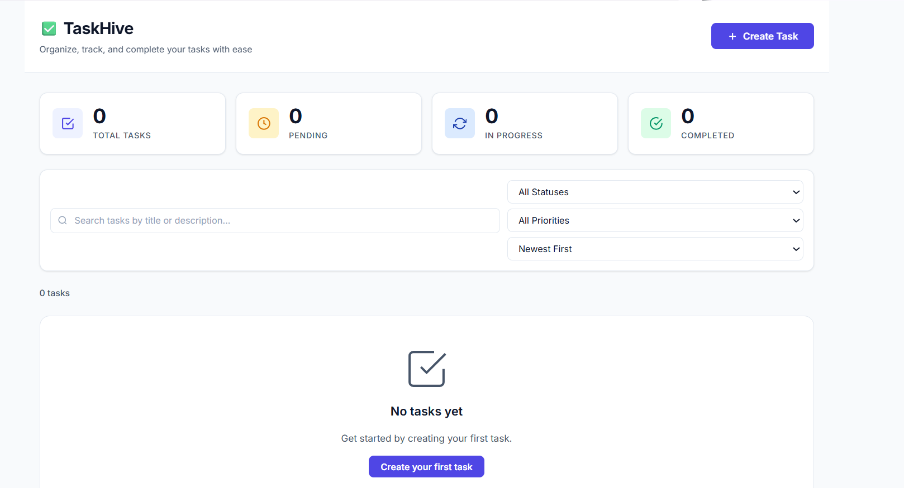
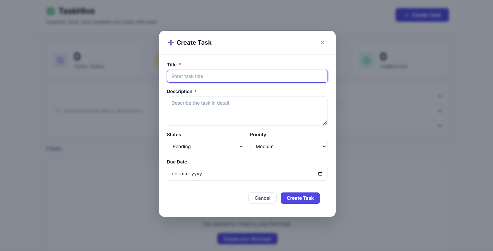
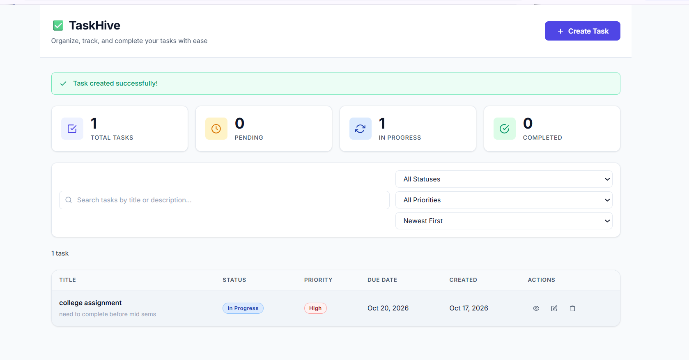
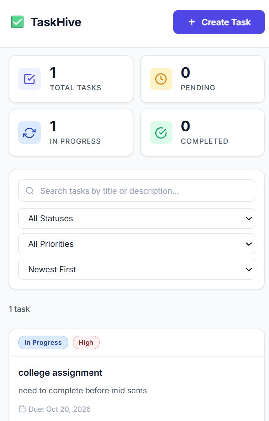
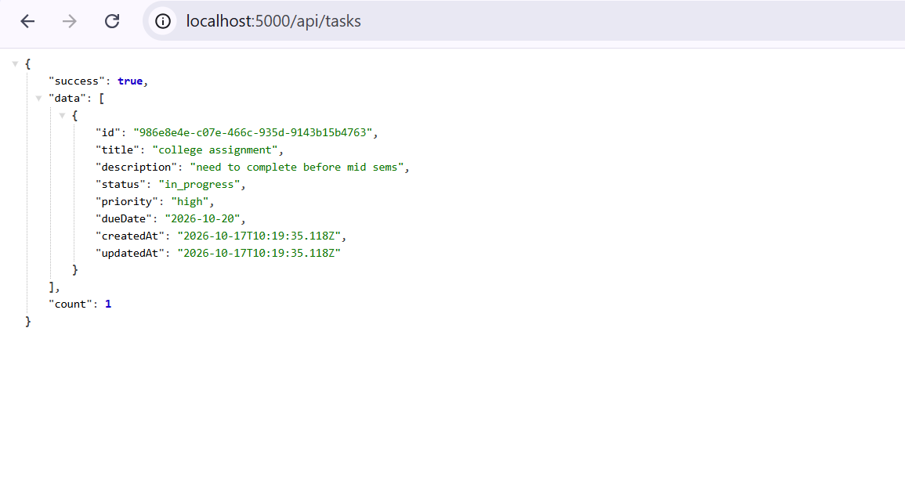

# TaskHive Task Management System

A full-stack task manager built with React, Vite, Node.js, and Express. It demonstrates a responsive dashboard, REST CRUD operations, validation, and separation between backend routes, controllers, and services.

## Features

- Create, view, edit, and delete tasks.
- Track status, priority, due date, creation time, and last update time.
- Search titles and descriptions; filter by status and priority; sort by date or priority.
- Debounced search, summary counts, loading/empty/error states, and delete confirmation.
- Responsive desktop table and tablet/mobile task cards.
- In-memory task storage; data resets whenever the backend restarts.

## Technology Stack

- Frontend: React 18, Vite 5, Axios
- Backend: Node.js ES modules, Express 4, CORS, dotenv
- Storage: in-memory JavaScript array; no database or authentication

## Project Structure

```text
backend/
  src/controllers/task.controller.js
  src/middleware/errorHandler.js
  src/routes/task.routes.js
  src/services/task.service.js
  src/app.js
  src/server.js
  test/
  .env.example
frontend/
  src/components/
  src/hooks/useModalAccessibility.js
  src/pages/Dashboard.jsx
  src/services/taskApi.js
  src/utils/helpers.js
  src/App.jsx
  src/App.css
  public/favicon.svg
  .env.example
docs/TaskHive.postman_collection.json
screenshots/
```

## Prerequisites

- Node.js 18 or newer and npm
- A modern browser

## Setup and Run

Run the backend in terminal 1:

```powershell
cd backend
npm install
Copy-Item .env.example .env
npm run dev
```

On macOS/Linux, use `cp .env.example .env` instead of `Copy-Item`.

Use `npm start` for a regular backend start. `npm run build` checks backend entry-point syntax.

Run the frontend in terminal 2:

```powershell
cd frontend
npm install
Copy-Item .env.example .env
npm run dev
```

Open the Vite URL printed in the terminal, normally <http://localhost:5173>. Run `npm run build` in `frontend/` to create the production bundle.

## Running Tests

The backend includes API tests in `backend/test`:

```powershell
cd backend
npm test
```

## Environment Variables

Backend settings (`backend/.env.example`):

| Variable | Default | Purpose |
|---|---|---|
| `PORT` | `5000` | Express server port |
| `HOST` | `0.0.0.0` | Interface to bind |
| `ALLOWED_ORIGINS` | `http://localhost:5173,http://localhost:3000` | Comma-separated explicit CORS origins |
| `NODE_ENV` | `development` | Development behavior and error details |

Frontend setting (`frontend/.env.example`):

| Variable | Default | Purpose |
|---|---|---|
| `VITE_API_URL` | `http://localhost:5000/api` | Backend API base URL |

Actual `.env` files are local-only and ignored by Git. Do not commit secrets. No database settings are needed.

## API Documentation

Import [docs/TaskHive.postman_collection.json](docs/TaskHive.postman_collection.json) into Postman. It defines `baseUrl` (`http://localhost:5000/api`) and stores the created task ID in `taskId`.

Task status is `pending`, `in_progress`, or `completed`; priority is `low`, `medium`, or `high`. `dueDate` is optional and uses a valid `YYYY-MM-DD` calendar date.

| Method | Endpoint | Success / error status |
|---|---|---|
| `GET` | `/api/tasks` | `200` list and count |
| `GET` | `/api/tasks/:id` | `200`, `404` if absent |
| `POST` | `/api/tasks` | `201`, `400` for invalid input |
| `PUT` | `/api/tasks/:id` | `200`, `400` invalid input, `404` if absent |
| `DELETE` | `/api/tasks/:id` | `200`, `404` if absent |

Example create request:

```http
POST http://localhost:5000/api/tasks
Content-Type: application/json

{
  "title": "Complete assignment",
  "description": "Build the full-stack task manager",
  "status": "pending",
  "priority": "high",
  "dueDate": "2026-10-20"
}
```

Example response (`201 Created`):

```json
{
  "success": true,
  "data": {
    "id": "generated-uuid",
    "title": "Complete assignment",
    "description": "Build the full-stack task manager",
    "status": "pending",
    "priority": "high",
    "dueDate": "2026-10-20",
    "createdAt": "2026-10-17T09:00:00.000Z",
    "updatedAt": "2026-10-17T09:00:00.000Z"
  },
  "message": "Task created successfully."
}
```

Example validation response (`400 Bad Request`):

```json
{
  "success": false,
  "message": "Validation failed.",
  "errors": ["Title is required and cannot be blank."]
}
```

Search, status/priority filtering, and sorting currently run in the frontend after `GET /api/tasks`; the API does not implement those query parameters. `GET /health` returns a service status.

## Design Decisions and Assumptions

- The assignment requires in-memory storage and disallows databases. Restarting the backend clears all tasks.
- Search, filtering, sorting, and summary counts run in the browser because the task list is small and the specified API is CRUD-only.
- Title and description are required. Status and priority default to `pending` and `medium`; due date is optional.
- `PUT` accepts partial updates, including a status-only update.
- CORS allows requests without an Origin, configured origins, and localhost/127.0.0.1 development ports when `NODE_ENV` is not `production`.

## Screenshots

### Dashboard


### Create Task


### Task Created


### Mobile View


### Backend API


## Known Limitations

- Data is volatile; there is no authentication or user separation, as allowed by the brief.
- Search/filter/sort are client-side; pagination is not implemented.
- The API is intended for local assignment evaluation, not production deployment.